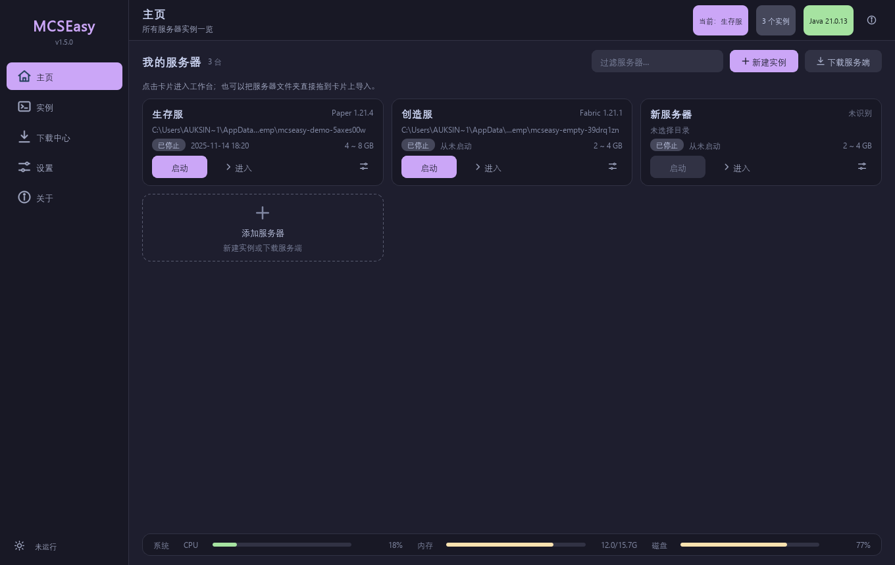
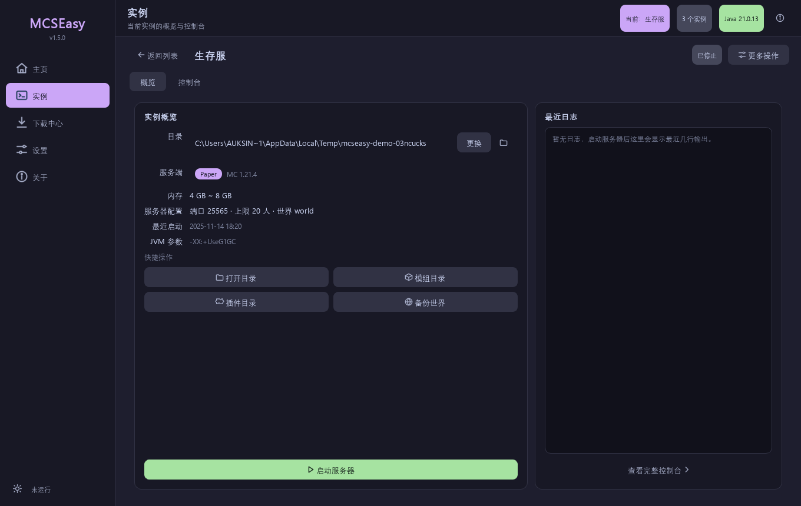
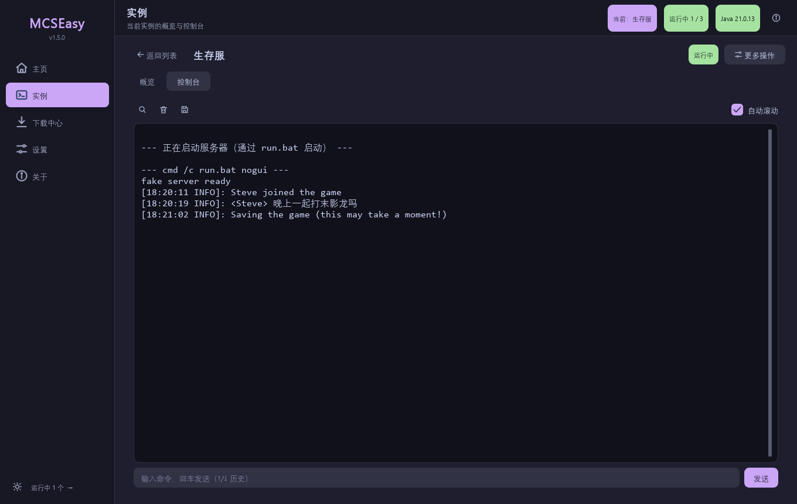
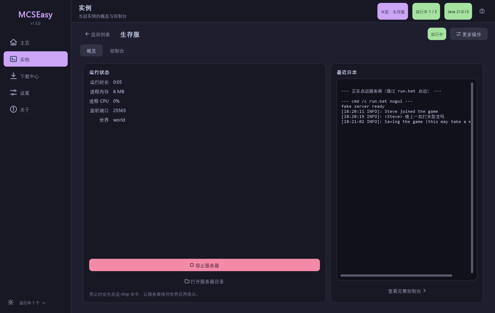
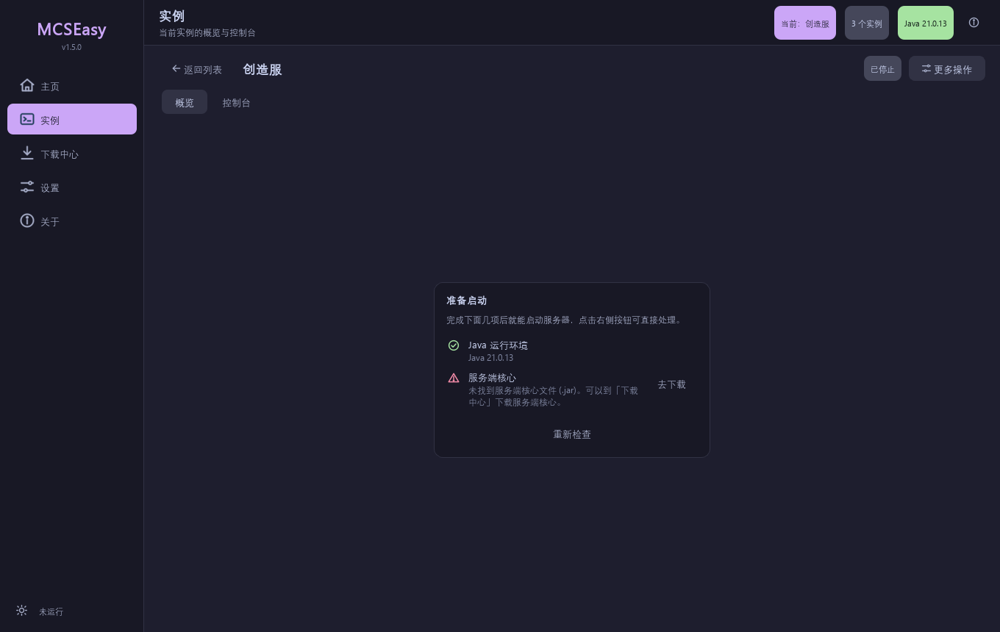
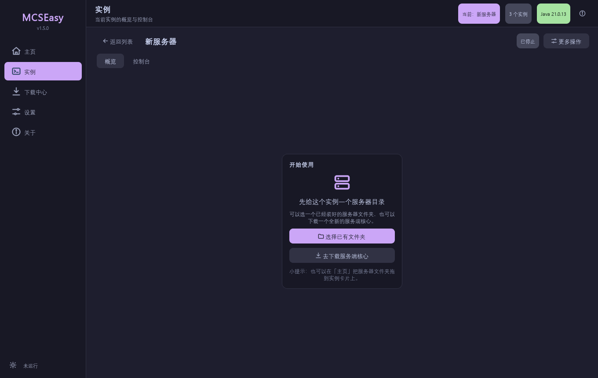
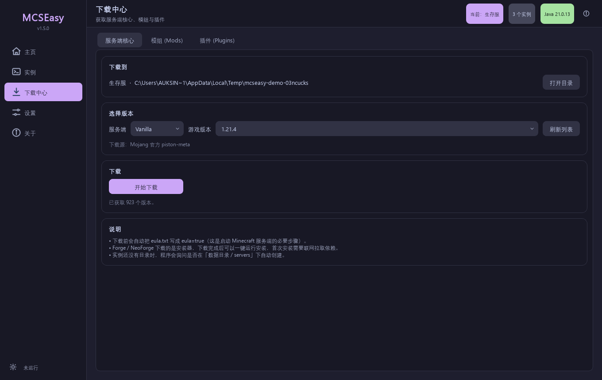
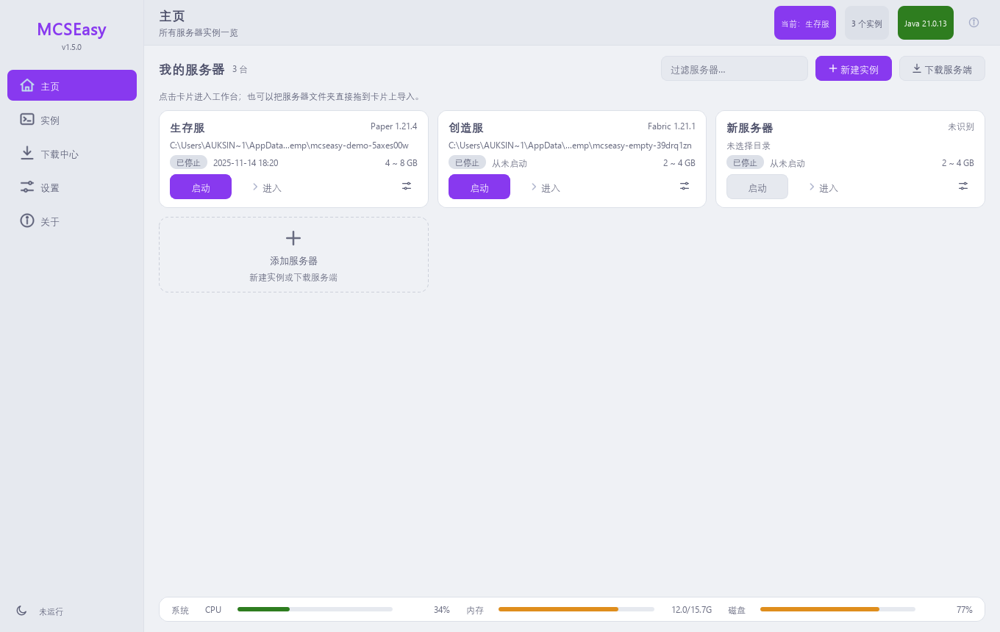

# Minecraft 简易开服程序 MCSEasy

<p align="center">
  
</p>

<div align="center">
<p align="center">
  <b><a>简体中文</a> | <a href="./docs/README_ZHTW.md">繁體中文</a> | <a href="./docs/README_ENG.md">English</a></b>
</p>

[](https://github.com/GoldenHoe/MCSEasy)
[](https://github.com/GoldenHoe/MCSEasy/blob/main/LICENSE)


</div>

### 用于*帮助有需要创建 Minecraft 服务器的用户开启并监视他们的 MC 服务器*

---

## 概述

MCSEasy 是一个用 **Python + Qt (PySide6)** 编写的 Minecraft 服务器部署与监视工具。
它把「装服务端、改配置、看日志」收敛到一个窗口里，并拆成两个层次：

- **主页 = 服务器卡片墙**：一眼看清「我有哪几台服务器、它们现在怎么样」
- **实例工作台 = 单台服务器的一切**：概览（按状态引导）+ 控制台（日志与命令）

两者之间用明确的路径连接：点卡片进入工作台 → 启动后自动切到控制台 → 返回列表。
下载中心、设置、关于各自独立，不挤在主页里。

## 界面预览

| 主页：服务器卡片墙 | 实例工作台：概览 + 最近日志预览 |
| --- | --- |
|  |  |

| 实例工作台：控制台 | 运行状态（进程级指标） |
| --- | --- |
|  |  |

| 准备清单（缺什么、怎么补） | 首次使用引导 |
| --- | --- |
|  |  |

| 下载中心 | 浅色主题 |
| --- | --- |
|  |  |

## 主要功能

- **服务器卡片墙（主页）**
  - 每张卡片显示名称、类型/版本、目录、最近启动、内存与状态（运行中 / 已停止 / 启动中…）
  - 卡片上直接启动 / 停止，或点「进入」打开工作台
  - 支持关键字过滤；把服务器文件夹**拖到卡片上**即可导入
  - 末尾有「添加服务器」占位卡，空列表也不至于无从下手
  - 底部是一条细系统状态条（CPU / 内存 / 磁盘），不抢主内容注意力

- **实例工作台（实例页）**
  - **概览**：按状态自动切换四种面板 —— 开始使用 → 准备启动（Java / 核心 / 端口清单）→ 实例概览 → 运行状态
  - **最近日志**：概览右侧实时预览最后几十行，点「查看完整控制台」即可跳转
  - **控制台**：逐实例独立日志、命令输入（↑/↓ 历史）、Ctrl+F 查找、导出、自动滚动、2 万行上限
  - 启动服务器后自动切到控制台；停止后仍保留完整日志

- **服务端核心下载**：Vanilla、Paper、Fabric、Forge、NeoForge
  - 自动写入 `eula.txt`；Forge / NeoForge 支持一键运行安装器并实时显示日志
  - 现代 Forge 会自动识别 `run.bat` / `run.sh` / `*_args.txt` 启动方式
  - 从工作台跳转下载时，下载完成会自动回到该实例

- **模组与插件**：内置 [Modrinth](https://modrinth.com/) 搜索，按游戏版本与加载器筛选，选择具体版本后下载到 `mods` / `plugins`

- **主题与可访问性**
  - 深色 / 浅色主题、窗口不透明度、控制台字号
  - 全部交互控件可用键盘到达；`Ctrl+1`–`Ctrl+5` 直达页面，`F1` 查看快捷键
  - 图标按钮有悬停提示与无障碍名称；仪表数值可被屏幕阅读器朗读
  - 状态不只依赖颜色：启动中 / 运行中 / 停止中 / 已停止都有文字
  - 文字对比度按 WCAG AA 调整

- **健壮性**
  - 网络请求带超时与重试；下载先写 `.part` 再原子改名
  - 线程统一托管，退出时取消并等待，不会出现「线程仍在运行」的崩溃
  - 启动前统一自检；端口占用会在启动前提示
  - 从日志识别 `UnsupportedClassVersionError`、`OutOfMemoryError`、端口冲突并给出中文建议
  - 关闭窗口时先向运行中的服务器发送 `stop`，必要时强制结束

## 快速开始

### 方式一：下载发行版

到 [Releases](https://github.com/HOE-Team/MCSEasy/releases) 下载对应平台的压缩包，解压后直接运行：

- Windows：`MCSEasy-vx.x.x.x-<发行类型>.exe`
- macOS：`MCSEasy-vx.x.x.x-<发行类型>`
- Linux：`MCSEasy-vx.x.x.x-<发行类型>`

首次启动后建议先到「设置」页确认 Java 已被正确识别。

### 方式二：从源码运行

需要 Python 3.10 或更高版本。

```bash
git clone https://github.com/HOE-Team/MCSEasy.git
cd MCSEasy

python -m venv .venv
# Windows
.venv\Scripts\activate
# macOS / Linux
source .venv/bin/activate

pip install -r requirements.txt
python main.py
```

### 方式三：自行打包

```bash
pip install -r requirements-dev.txt
pyinstaller --clean --noconfirm --onefile --windowed --name=MCSEasy \
  --add-data "svg;svg" --add-data "icon.png;." --add-data "icon.ico;." \
  main.py
```

> macOS / Linux 下把 `;` 换成 `:`，例如 `--add-data "svg:svg"`。
> 打包后可用 `MCSEasy --selftest` 做一次离屏自检。

## 环境要求

| 项目 | 要求 |
| --- | --- |
| 操作系统 | Windows 10/11、macOS 11+、主流 Linux 桌面发行版 |
| Python（源码运行） | 3.10 及以上 |
| Java | 1.17 以下建议 Java 8，1.18 及以上建议 Java 17/21 |
| 网络 | 首次下载服务端与模组时需要 |
| 磁盘 | 至少 8 GB 可用空间（含世界存档） |

## 数据与配置文件位置

程序不会把配置写进安装目录，方便升级与迁移：

| 平台 | 目录 |
| --- | --- |
| Windows | `%APPDATA%\MCSEasy` |
| macOS | `~/Library/Application Support/MCSEasy` |
| Linux | `~/.local/share/MCSEasy` |

其中：

- `settings.ini`：界面与 JVM 设置、实例列表
- `logs/mcseasy.log`：滚动日志（单文件 2 MB，保留 5 个）
- `assets/`：主题用到的着色图标缓存
- `servers/`：未指定目录时，服务端默认下载到这里

> 需要便携化时，可以设置环境变量 `MCSEASY_DATA_DIR` 指定数据目录。

## 快捷键

| 快捷键 | 功能 |
| --- | --- |
| `Ctrl + N` | 新建实例 |
| `Ctrl + F` | 在当前控制台中查找 |
| `Ctrl + ,` | 打开设置 |
| `Ctrl + 1 / 2 / 3 / 4 / 5` | 切换到主页 / 实例 / 下载中心 / 设置 / 关于 |
| `Ctrl + Tab` / `Ctrl + Shift + Tab` | 循环切换页面 |
| `F5` | 刷新当前页面 |
| `F1` | 快捷键与帮助 |
| `Enter` | 发送控制台命令 |
| `↑ / ↓` | 翻阅历史命令 |
| 拖放文件夹 | 把服务器文件夹拖到主页的实例卡片上即可设置目录 |

## 常见问题

<details>
<summary><b>提示未检测到 Java</b></summary>

到「设置 → Java 运行环境」点「手动选择 java」，选中 `.../bin/java.exe`（Windows）或 `.../bin/java`（macOS/Linux）。
也可以先安装 [Adoptium Temurin](https://adoptium.net/) 后点「重新检测」。
实例工作台的「准备启动」清单会直接显示 Java 是否就绪。
</details>

<details>
<summary><b>Forge / NeoForge 下载完成后无法直接启动</b></summary>

Forge 系服务端需要先运行安装器生成运行环境。下载完成后程序会询问是否立即运行安装器；
如果选择稍后安装，工作台的「准备启动」清单会显示「运行安装器」按钮，或手动执行
`java -jar forge-*-installer.jar --installServer`。
</details>

<details>
<summary><b>控制台出现乱码</b></summary>

程序会按 UTF-8 → GBK 的顺序自动识别服务端输出编码。若仍有个别乱码，可在「设置 → 全局 JVM 参数」中加入
`-Dfile.encoding=UTF-8`，并在服务端配置中确认控制台编码与系统一致。
</details>

<details>
<summary><b>启动后立刻退出，控制台出现 UnsupportedClassVersionError</b></summary>

这是 Java 版本过低。程序会在通知中提示，请到「设置 → Java 运行环境」换成与 Minecraft 版本匹配的 Java
（1.18+ 建议 17，1.20.5+ 建议 21）。
</details>

<details>
<summary><b>版本列表一直加载失败</b></summary>

版本列表来自 Mojang / PaperMC / FabricMC / Modrinth 等公共接口，网络受限时可能失败。
可以尝试：检查代理、稍后点「刷新列表」，或直接手动输入版本号后开始下载。
</details>

<details>
<summary><b>关闭窗口时提示服务器仍在运行</b></summary>

程序会先向服务器发送 `stop` 命令，等待其保存世界并退出；若在「设置 → 服务器停止行为」中启用了超时强制结束，
超时后会自动结束进程。你也可以选择取消退出。
</details>

## 项目结构

```
MCSEasy/
├── main.py                 # 程序入口（Qt 初始化、日志、异常兜底、--selftest）
├── mcseasy/
│   ├── config.py           # 版本号、目录定位、日志
│   ├── theme.py            # 深/浅色主题、QSS、SVG 图标
│   ├── model.py            # 实例模型、Java 探测、启动自检、启动命令推导
│   ├── services.py         # 服务端/Modrinth 接口（纯函数）
│   ├── net.py              # 带超时与重试的下载封装
│   ├── workers.py          # 后台线程、资源与进程采样、线程池
│   ├── widgets.py          # 仪表、检查清单、卡片控件、控制台
│   ├── dialogs.py          # JVM / 版本 / 安装器 / 快捷键帮助
│   ├── pages/
│   │   ├── instances.py    # 主页：服务器卡片墙
│   │   ├── workspace.py    # 实例工作台：概览 + 控制台
│   │   ├── download.py     # 下载中心
│   │   ├── settings.py     # 设置
│   │   └── about.py        # 关于
│   └── window.py           # 主窗口、导航与服务器进程管理
├── svg/                    # 界面图标
├── tests/                  # 单元测试与界面集成测试
└── docs/                   # 文档与多语言 README
```

## 开发与测试

```bash
pip install -r requirements.txt
python -m unittest discover -s tests -v
```

测试覆盖了排序/格式化、编码自动识别、实例序列化与迁移、EULA 处理、启动命令推导与启动自检、
下载（含取消）、Modrinth 解析，以及真实窗口的构建、主题切换、实例增删改、卡片→工作台导航、
状态面板切换、实例过滤、拖放导入与「启动 → 输出 → 命令 → 停止」的完整进程流程（离屏渲染，无需显示器）。

## 注意事项

根据你的计算机性能和网络状况，某些操作（下载与启动）可能需要一些时间。

## * AI 内容生成提示

本项目部分代码由 ChatGPT / Google Gemini / DeepSeek 辅助生成，后续已由人工审查和修改。
AI 生成的内容仅用于提高开发效率，不保证完全正确性。项目维护与责任由开发者承担。

## 贡献与反馈

如果你发现任何问题或有改进建议，请发送邮件到 **hoe_team@outlook.com**，
或在 [GitHub Issues](https://github.com/HOE-Team/MCSEasy/issues) 中反馈。
也欢迎任何形式的贡献，包括代码、文档和测试。

本项目应用图标生成自 [AppIcon Force](https://zhangyu1818.github.io/appicon-forge/)

## 许可证

Copyright © 2024-2025 HOE Team

项目遵循 [MIT 许可证](https://github.com/HOE-Team/MCSEasy/blob/main/LICENSE)

> [!NOTE]
> 这份许可证意味着：
>
> 1. **你可以随意使用这个项目代码**，无论是在个人项目还是商业项目中。
> 2. **你可以修改并重新发布**这个代码。
> 3. **你甚至可以用它来开发商业软件并销售**，只要你在你的产品中包含原始的 MIT 许可证文本和版权声明。
> 4. **作者不提供任何保证**，如果使用该软件导致任何问题，你需要自己承担风险。
